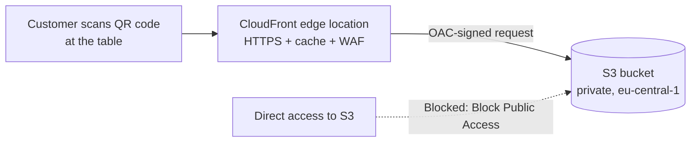

# Static Restaurant Menu on AWS: S3 + CloudFront with Origin Access Control

Hosting a QR-code restaurant menu (single-file HTML, Greek/English) on AWS using a **private S3 bucket** behind **Amazon CloudFront**, secured with **Origin Access Control (OAC)**, served over HTTPS, at **$0/month** on the CloudFront flat-rate Free plan.

This was a real project for a friend's restaurant (*Yamas – Art of Sharing*), and I used it as a hands-on way to learn the AWS console and core services.

---

## Architecture



| Component | Choice | Why |
|---|---|---|
| Storage | S3 General purpose bucket, `eu-central-1` (Frankfurt) | Cheap, durable object storage; Frankfurt is a common low-latency region for Greece |
| Delivery | CloudFront distribution, **Free flat-rate plan** | Global CDN, free TLS certificate, caching, WAF included, no overage charges |
| Access control | **Origin Access Control (OAC)** | Only CloudFront can read the bucket; the bucket stays fully private |
| Public access | S3 **Block all public access: ON** | Nobody can reach the objects directly via S3 URLs |

---

## Why a private bucket + OAC instead of S3 static website hosting?

The "classic" approach is to enable *Static website hosting* on S3 and make the bucket public. I deliberately did **not** do that:

- **The S3 website endpoint is HTTP only.** You need CloudFront anyway for HTTPS.
- **A public bucket is a common misconfiguration** and a frequent source of data leaks. Keeping Block Public Access on is the safer default.
- **OAC enforces a single entry point.** All traffic goes through CloudFront, where caching and WAF apply.
- **OAC replaces the legacy Origin Access Identity (OAI)** and is the approach AWS currently recommends.

---

## Implementation steps

### 1. Account preparation
- Enabled **MFA on the root user** and used a separate admin identity for daily work.
- Created a **Zero spend budget** in AWS Budgets, which sends an email alert on the first cent of spend.
- Note: the CloudFront flat-rate plans (including the $0 Free plan) require an account on the AWS **Paid plan**. Accounts on the 6-month AWS Free plan cannot subscribe to them.

### 2. S3 bucket
- Region: `eu-central-1`
- Bucket type: General purpose
- Object Ownership: **ACLs disabled** (access controlled by policies only)
- Block Public Access: **all enabled**
- Versioning: disabled (single static file, avoids storing old versions)
- Encryption: SSE-S3 (default)
- Tag: `Project = yamas-menu`
- Uploaded `index.html` to the bucket root

### 3. CloudFront distribution
- Pricing plan: **Free** ($0/month)
- Distribution type: Single website configuration
- Origin type: Amazon S3, using the REST endpoint (`<bucket>.s3.eu-central-1.amazonaws.com`), **not** the `s3-website` endpoint
- **Allow private S3 bucket access to CloudFront: enabled.** This creates the OAC and updates the bucket policy automatically.
- Security: default WAF protections included in the Free plan
- **Default root object:** `index.html`

### 4. Bucket policy (generated by OAC)

CloudFront wrote a bucket policy similar to this, allowing reads **only** from this specific distribution:

```json
{
  "Version": "2008-10-17",
  "Statement": [
    {
      "Sid": "AllowCloudFrontServicePrincipal",
      "Effect": "Allow",
      "Principal": { "Service": "cloudfront.amazonaws.com" },
      "Action": "s3:GetObject",
      "Resource": "arn:aws:s3:::<bucket-name>/*",
      "Condition": {
        "StringEquals": {
          "AWS:SourceArn": "arn:aws:cloudfront::<account-id>:distribution/<distribution-id>"
        }
      }
    }
  ]
}
```

The `AWS:SourceArn` condition matters: without it, *any* CloudFront distribution (including one in someone else's account) could be pointed at the bucket.

### 5. Verification
- Opened `https://<distribution>.cloudfront.net` on a phone over mobile data.
- Checked the HTTPS padlock, embedded images, the language toggle, and that external fonts and icons load.
- Confirmed that the direct S3 object URL returns **Access Denied**, as intended.

---

## Cost

| Item | Cost |
|---|---|
| CloudFront Free plan (1M requests, 100 GB transfer, 5 GB S3 storage/month) | $0 |
| S3 → CloudFront data transfer | $0 (always free) |
| TLS certificate | $0 (included) |
| **Total** | **$0/month** |

The page is about 77 KB, with images embedded as base64 WebP, so the Free plan limits are far above realistic restaurant traffic. Flat-rate plans have **no overage charges**: if limits are exceeded, delivery may be throttled rather than billed.

---

## Troubleshooting and lessons learned

| Problem | Cause | Fix |
|---|---|---|
| "No buckets" in CloudFront's *Browse S3* | Bucket hadn't been created yet | Created it in a separate tab, then refreshed the picker |
| Uploaded file was named `index.hmtl.html` | Windows hides known file extensions, so a rename produced a double extension (plus a typo) | Enabled **File name extensions** in Explorer and renamed to `index.html`. CloudFront's default root object must match exactly. |
| Console defaulted to `eu-north-1` | The console remembers the last-used region | Switched to `eu-central-1` before creating the bucket. The S3 bucket list is global, but the region is fixed at creation. |
| Free plan prerequisites | Flat-rate plans aren't available to AWS Free-plan accounts | Used an account on the Paid plan, with a zero-spend budget as a safety net |

---

## Next steps

- [ ] Custom domain (e.g. `menu.<restaurant>.gr`) so the printed QR code never depends on the `cloudfront.net` hostname
- [ ] Generate the QR code from the final URL
- [ ] Update workflow: re-upload `index.html` and run a CloudFront **invalidation** (`/*` or `/index.html`)
- [ ] Move photos from base64 into a `photos/` prefix in S3 as the menu grows, so images lazy-load instead of inflating the HTML
- [ ] Automate deployment with the AWS CLI (`aws s3 cp` + `aws cloudfront create-invalidation`)

---

## Skills demonstrated

`Amazon S3` · `Amazon CloudFront` · `Origin Access Control` · `S3 bucket policies` · `IAM / least privilege` · `AWS Budgets` · `CDN caching` · `HTTPS/TLS` · `Cost optimization`
